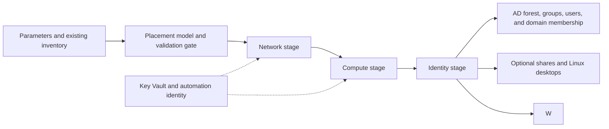
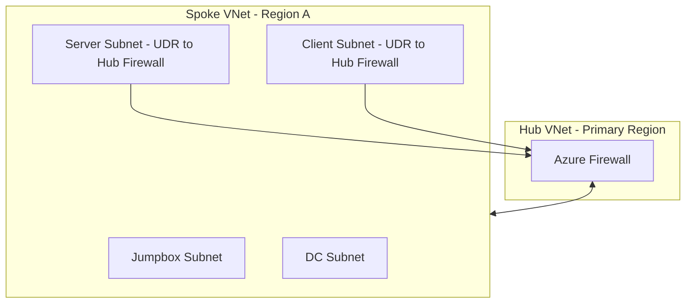

# Architecture

## Overview

AMRL is a subscription-scope Bicep deployment for a multi-region Active Directory lab. It creates resource groups, selectable VNet topologies, subnet and NSG segmentation, virtual machines, and directory services in the identity stage.

The first selected region is the hub and control-plane anchor. Newly placed `dc01` and `jmp01` are assigned there; additional regions provide spoke capacity. `networkMode` selects connectivity and routing independently of VM placement. Retained VMs keep their declared locations.

## Deployment Model

The root template derives placements from parameter files and declared existing inventory, evaluates configuration findings, and orchestrates three stages:



Network outputs supply subnet IDs to compute. Compute creates missing VMs; identity configures guest services and can also activate missing workload creation when needed. Foundation resources hold credentials and authorize applicable automation. See [Deployment Stages](deployment.md#stages) for stage prerequisites.

| Component | Role in the lab |
|---|---|
| Primary and replica DCs | Host AD and domain DNS; provision them during the identity stage after network and compute prerequisites are ready. |
| Jumpboxes | Provide the administration hop to private workload VMs; Bastion is an optional additional access path. |
| Windows/Linux servers and clients | Exercise domain membership, administration policy, applications, and optional desktop access. |
| Windows Admin Center | Optional gateway installation and configuration repair during identity-stage after AD/GPO and Windows domain joins, on the primary jumpbox or first modeled Windows server. The gateway UI uses HTTPS; current managed-server WinRM uses HTTP. AMRL does not configure inbound web access or automatically populate Shared Connections. |
| Directory and file services | Provide the departmental user/group model, GPOs, and optional group-based share permissions. |

Region and VM counts, role-specific images/sizes/disks, and optional services are data-driven. New-VM creation uses missing identities only; identity automation can also target retained VMs. Detailed placement rules belong in [Placement and Reconciliation](placement-and-reconciliation.md), and guest configuration in [Identity and Domain Join](identity-and-domain-join.md).

## Core Terminology

- **Greenfield deployment**: Creating entirely new infrastructure from scratch. All networking, compute, and identity resources are created fresh.
- **Brownfield deployment**: Reusing existing infrastructure (typically networking) and adding new resources on top. Controlled by the `existingRegions` parameter.
- **Reconciliation model**: Declared inventories retain existing VM identities while selected automation creates missing objects and repairs supported configuration.
- **AGDLP**: Global Security Groups (containing users) are nested into Domain Local Security Groups (which hold the actual file share permissions).
- **Stage**: Deployment execution mode that controls which resource types are deployed (`network`, `compute`, `identity`, or `all`). See [Deployment Guide](deployment.md#stages).
- **DC (Domain Controller)**: Primary (`dc01`) or replica (`dc02`, `dc03`, etc.) domain controllers. The primary DC creates the forest; replicas sync from it.
- **Idempotent**: Repeated execution avoids unnecessary recreation for supported operations; each feature has its own repair and migration boundaries.

## Design Principles

- Deterministic deployment: the same inputs always produce the same infrastructure layout.
- Separation of concerns: networking, compute, security, and placement logic are clearly separated into modules.
- Data-driven design: deployment behaviour is controlled through parameter configuration, not template edits.
- Validation before deployment: invalid configurations are surfaced through validation outputs.
- Deterministic, capacity-aware placement: in multi-region deployments, new workloads fill remaining spoke capacity slots in region-index order rather than being evenly balanced. Validation reports insufficient capacity and regional overflow; blocking findings stop stages only in `enforce` mode.
- Security-first approach: minimal exposure, controlled access paths (jumpboxes), and Key Vault-backed credentials.

## Infrastructure as Code

The deployment is declarative. Bicep describes the desired resources, their configuration, scopes, and dependencies. Parameters provide the environment-specific inputs, including regions, VM counts, VM sizes, images, credentials references, and deployment stage.

The root [main.bicep](../main.bicep) orchestrates the deployment. Reusable modules own specific resource types:

- `modules/networking` owns VNets, role subnets, NSGs, firewalls, and route tables.
- `modules/networking/peering.bicep` owns mode-specific hub-spoke or full-mesh peering.
- `modules/compute` owns Windows and Linux VM resources.
- `modules/identity/wac.bicep` owns optional Windows Admin Center installation through VM Run Command.
- `modules/identity` owns AD automation, domain joining, and departmental file-service provisioning.
- `modules/logic` owns configuration and capacity validation.

### Source Organization

[main.bicep](../main.bicep) groups inputs, placement calculations, stage orchestration, and outputs by purpose. Module and script introductions explain ownership, prerequisites, and reconciliation boundaries. Bicep references and `dependsOn` determine deployment order; scripts retain dependency-sensitive execution order.

## Resource Scope

`main.bicep` uses subscription scope so it can create one resource group per selected region. Regional resources are deployed into their corresponding resource group with module-level resource-group scope.

## Network Topology

The `networkMode` parameter supports three topology creation modes:

| Mode | Peerings | Firewall and routing | Cross-spoke connectivity |
|---|---|---|---|
| `hubSpokeFirewall` | Hub-to-spoke and spoke-to-hub | Azure Firewall, firewall policy, `AzureFirewallSubnet`, route tables, and UDRs | Routed through the hub firewall. |
| `hubSpoke` | Hub-to-spoke and spoke-to-hub | None | Not available. Azure VNet peering is non-transitive. |
| `fullMesh` | Every pair of distinct regions | None | Direct VNet peering between every region. |

`hubSpoke` is suitable for management-focused or firewall-introduction staging environments. It is not a lower-cost replacement for firewall-routed cross-spoke workloads. `fullMesh` avoids Azure Firewall and UDR management, but VNet peering traffic costs and the growing number of peerings should be considered.

For existing environments, [Brownfield Topology Simplification](deployment.md#brownfield-topology-simplification) describes supported transitions, peering cleanup, and Bastion retirement.

## Network Layout

Each region receives a VNet address space derived from its region index:

```text
10.<region index>.0.0/16
```

Subnet indexes are supplied through `subnetIndexMap`. The standard layout is:

```text
firewall = 0
bastion  = 1
jumpbox  = 2
dc       = 3
server   = 4
client   = 5
```

All modes contain control-plane and role-based workload subnets. In `hubSpokeFirewall`, the hub additionally contains the firewall and `AzureFirewallSubnet`, while spokes receive route tables. NSGs restrict administration and AD traffic by subnet role in every mode.

### Network Architecture Diagram



This diagram applies to `hubSpokeFirewall`: spoke VM -> route table -> hub firewall -> destination. `hubSpoke` has no spoke-to-spoke path; `fullMesh` uses direct peerings instead.

### Subnet Roles and NSG Rules

NSG rules are composed per role in `modules/networking/vnet.bicep` from shared rule building blocks (`adRules`, `adAdvancedRules`, `rdpRules`, `sshRules`):

| Subnet role | Composition | Effective access |
|---|---|---|
| `dc` | `adRules` + `adAdvancedRules` + `rdpRules` | DNS (53), Kerberos (88), LDAP (389), NTP (123), Kerberos password change (464), SMB (445), Global Catalog (3268/3269), LDAPS (636), RPC endpoint mapper (135) and dynamic (49152–65535) from `10.0.0.0/8`; RDP (3389) from jumpbox subnets only |
| `jumpbox` | Single rule | RDP (3389) from `jumpboxAllowedSources` only |
| `server` | `sshRules` + `rdpRules` + `adRules` | SSH (22) and RDP (3389) from jumpbox subnets only; DNS/Kerberos/LDAP from `10.0.0.0/8` |
| `client` | `sshRules` + `rdpRules` | SSH (22) and RDP (3389) from jumpbox subnets only |
| `AzureFirewallSubnet` (hub only) | No NSG | Azure Firewall manages its own rule collections directly |

All rules use `protocol: '*'` and `sourcePortRange: '*'`, relying on Azure NSG stateful filtering to allow return traffic.

### IP Addressing Strategy

All VM NICs, including DC NICs, use dynamic private IP allocation. In a fresh DC-only subnet, a DC is likely to receive `.4`, the first usable address, but the template does not reserve or verify it. Multiple DCs may occupy different addresses; the important requirement is that the configured DNS endpoint hosts a reachable, working domain DNS service. See [DNS and Domain Connectivity](validation-and-troubleshooting.md#dns-and-domain-connectivity) for lifecycle and readiness checks.

### DNS Configuration and Strategy

The template calculates up to three DNS server candidates from `.4` addresses in regions containing declared DC placements (see `dnsCandidates`/`dnsServers` in `main.bicep`). It does not discover actual NIC addresses or verify that a working DC occupies each candidate address:

1. The hub region's DC is prioritised when present.
2. Remaining regions containing DCs are appended in deterministic order.
3. The list is truncated to a maximum of three DNS servers.

Greenfield VNets receive the current DNS server list derived from DC placement. Brownfield (reused) VNets retain their existing DNS configuration; DNS normalisation across previously deployed VNets is not performed automatically.

Verify actual DC private IPs and VNet DNS settings during readiness checks, particularly after brownfield changes. Do not assume explicit address allocation or automatic DNS reconciliation, and do not change existing DC addresses implicitly.

## VM Security Features

All VMs (`modules/compute/vm-windows.bicep`, `modules/compute/vm-linux.bicep`) share the same security profile:

- **Trusted Launch**: SecureBoot and vTPM enabled to protect against boot-level attacks and rootkits.
- **System-assigned managed identity**: available to guest workloads for authorized Azure access; VM Run Command invocation is governed separately by deployment permissions.
- **Boot diagnostics**: enabled for troubleshooting startup issues.
- **Public IP assignment**: jumpbox VMs only; all other roles remain private.

## Controlled Egress

Controlled egress applies only to `hubSpokeFirewall`. Server and client subnets send both `10.0.0.0/8` and `0.0.0.0/0` to the Azure Firewall private IP, forcing internal cross-spoke traffic and Internet egress through the hub firewall. Spoke DC and jumpbox subnets send only `10.0.0.0/8` through the firewall, preserving direct Internet access while enabling cross-spoke directory services and administration. Hub DC and jumpbox subnets do not receive these route tables because the hub is directly peered with every spoke.

This is a controlled-egress design rather than a block-all design: outbound connectivity is still allowed where required, but it is centralized and inspectable at the firewall instead of being direct from the workload subnets.

## Topology Transition Boundary

The deployment creates and reconciles resources required by the selected mode, but it does not fully retire resources that are no longer selected. The network-reconciliation script enumerates candidate spoke-to-spoke peerings from `existingRegions` only for `hubSpoke` or `hubSpokeFirewall`; `fullMesh` skips peering queries and removal. Independently, it attempts retirement of framework-owned Bastion resources when `enableBastion=false`. It does not discover the prior topology. Firewall resources, route tables, UDR associations, `AzureFirewallSubnet`, and broader reverse-transition retirement remain outside the cleanup scope. See [Brownfield Topology Simplification](deployment.md#brownfield-topology-simplification) for invocation conditions, independent action gates, and verification requirements.

## Desired State

The template combines the desired VM model with `existingVmPlacements`. Existing VM identities are retained, missing VM identities are created, and the combined placement model is used for validation, DNS generation, capacity calculations, and identity targeting.

The template does not discover live Azure VM inventory. Brownfield users must maintain `existingVmPlacements` in the parameter file.

## File Services

File services are part of the identity workflow and are controlled independently by `enableFileServices`. Directory population runs on the primary DC and, when file services are enabled, creates the domain-local share groups and nests department manager/user groups into them. The separate `file-services.bicep` module then runs `Populate-Shares.ps1` on the selected host to create `C:\Shares`, one SMB share per selected department, and the corresponding NTFS access rules.

By default, the selected host is the primary DC. When `useDedicatedFileServer=true`, the first `srvwin` entry in `finalVmPlacements` is selected. The file-services module is scoped to that VM's resource group and depends on both AD population and Windows domain join, ensuring a dedicated server joins the domain before its AD-backed ACLs are applied.

[Back to README](../README.md)
