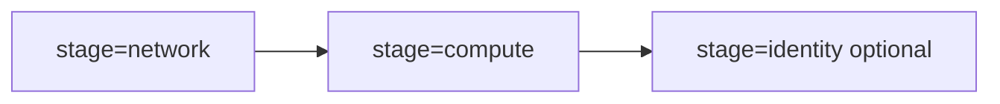

# Deployment Guide

[Back to README](../README.md)

## Prerequisites

- Azure CLI installed and authenticated.
- Access to the target subscription.
- A Key Vault containing the referenced credentials and SSH keys.
- VM sizes, images, regional quota, and regional availability verified for the subscription.
- A parameter file with valid region, network, compute, and identity settings.
- At least one domain controller requested with `vmCounts.dc >= 1`, even if `enableIdentity`, `enableFileServices`, and `useDedicatedFileServer` are all `false`.

For a new subscription or tenant, follow [New Subscription Setup](new-subscription-setup.md) instead of starting with the commands below. It includes prerequisites, shared values, and the complete sequence through deployment.

## Deployment Workflow

1. Choose regions, topology, VM counts, and optional identity/file services in the [parameter file](configuration-parameters-reference.md).
2. Check [regional availability and quota](#preflight-checks), then [build, validate, and preview](ci-cd-validation.md#local-validation).
3. Use the greenfield or brownfield path below and select the appropriate stage.
4. Review [deployment outputs and guest results](validation-and-troubleshooting.md#post-deployment-review).
5. Connect using [Access and Administration](access-and-administration.md).

## Stages

| Stage | Behavior |
|---|---|
| `network` | Creates or reuses regional networking and peerings. |
| `compute` | Creates missing DCs, jumpboxes, and workload VMs. Target VNets and role subnets must already exist. |
| `identity` | Configures AD, GPOs, workload domain membership, enabled file/desktop services, and WAC when enabled. Can create missing workloads; control-plane DCs must exist. |
| `all` | Runs the complete workflow. |

Use `stage=all` when both networking and VM creation are needed. For separate runs, use `network -> compute -> identity`, keeping declared inventory current between deployments. Stage flags select resources, but shared placement, validation, and module contracts are still evaluated.



Use a new deployment name when rerunning identity automation so Azure reapplies the VM Run Commands. Verify required connectivity, sign-in, and services after deployment; stage completion alone does not prove readiness.

### Validation Mode

- `reportOnly` reports blocking and advisory findings and allows the selected stages to run.
- `enforce` fails the validation gate when blocking findings are active; dependent stages do not run. Advisory findings remain non-blocking.

The engine completes before the gate, so its nested deployment retains diagnostics after enforcement failure. See [Deployment Results and Troubleshooting](validation-and-troubleshooting.md#post-deployment-review).

### Optional File Services

Set `enableIdentity=true` and `enableFileServices=true` and run `identity` or `all`. Shares use the primary DC unless `useDedicatedFileServer=true`, which selects the first `srvwin` VM in the final model. Request or inventory that server before enabling dedicated mode; [target reassignment is not data migration](placement-and-reconciliation.md#file-server-reassignment-on-brownfield-expansion).

### Optional Windows Admin Center

Set `enableIdentity=true` and `enableWindowsAdminCenter=true` to install Windows Admin Center during `stage=identity` or `stage=all`. WAC runs after AD/GPO provisioning and the Windows domain-join collection, so the selected host has had an opportunity to receive working domain DNS. By default it targets the primary jumpbox. Set `useDedicatedWacHost=true` to prefer the first `srvwin` in the final placement model; if none is modeled, installation falls back to the primary jumpbox and reports the advisory `missingDedicatedWacHost`.

WAC enabled without identity is a blocking `invalidWindowsAdminCenterIdentityConfiguration` finding. If WAC is enabled but the selected stage is not `identity` or `all`, WAC is skipped and `windowsAdminCenterSkippedForStage` is advisory.

The installer downloads the current WAC v2 EXE from `https://aka.ms/WACDownload` and silently runs it. It does not pin a release or explicitly set listener port, authentication, certificate, or WinRM options; review the installed configuration. The host needs outbound HTTPS and DNS that resolve the download endpoint. AMRL does not add inbound web rules or configure the gateway's managed-server connections. The script checks for the `WindowsAdminCenter` service and starts it if stopped; an existing service causes an early exit, not an upgrade or repair. Disabling WAC skips future installation commands but does not uninstall it from a retained VM.

## Greenfield Deployment

For a new environment, use an empty `existingRegions` array and an empty `existingVmPlacements` array. Set `vmCounts.dc` to at least `1`.

The current template evaluates the primary domain-controller and file-server target during validation regardless of the identity and file-service flags. A deployment with `vmCounts.dc=0` therefore fails template validation before resources are created.

Prerequisite: initialize `$parameterFile` and `$deploymentLocation` as shown in [Local Validation](ci-cd-validation.md#local-validation), then complete those checks before running this command.

```powershell
$deploymentName = 'amrl-' + (Get-Date -Format 'yyyyMMdd-HHmmss')
az deployment sub create `
  --name $deploymentName `
  --location $deploymentLocation `
  --template-file main.bicep `
  --parameters $parameterFile
```

## Brownfield Deployment

For an existing environment:

- List reused networking regions in `existingRegions`.
- List every retained VM in `existingVmPlacements`.
- Keep the original region indexes for existing VNets.
- Increase `regionCount` only after verifying the new regions and VM sizes.
- Increase VM counts to the desired totals; reconciliation creates only missing VM identities.

Example inventory entry:

```json
{
  "type": "srvlin",
  "index": 2,
  "regionKey": "centralindia"
}
```

## Controlled Egress

Controlled egress applies when `networkMode=hubSpokeFirewall`.

- Server and client workload subnets no longer have direct Internet access.
- Their default route is sent to the Azure Firewall private IP via the route table next hop.
- All outbound Internet traffic from those subnets is inspected and controlled at the firewall before leaving the environment.
- Internal traffic remains allowed, and firewall policy continues to allow required outbound HTTP/HTTPS flows.
- This is a controlled-egress model: the lab still has outbound connectivity where required, but it is centralized and inspectable at the firewall rather than exposed directly from workload subnets.

## Network Topology Modes

| `networkMode` | Deploys | Use case and boundary |
|---|---|---|
| `hubSpokeFirewall` | Hub-spoke peerings, Azure Firewall, policy, `AzureFirewallSubnet`, route tables, and UDRs | Full cross-spoke connectivity through the firewall with controlled workload egress. |
| `hubSpoke` | Hub-spoke peerings only | Management-focused or staging topology. Peering is non-transitive, so spokes cannot communicate with each other. |
| `fullMesh` | Direct peerings between every selected region | Lab, training, and test environments that need direct regional connectivity without firewall or UDR management. |

The hub remains the control-plane region in all modes. Selecting a mode does not change VM placement, DNS candidate selection, or identity orchestration.

### Brownfield Topology Simplification

Changing `networkMode` from `fullMesh` to `hubSpoke`, `fullMesh` to `hubSpokeFirewall`, or `hubSpoke` to `hubSpokeFirewall` and running `stage=network` is the currently supported brownfield topology simplification path. In these transitions, the deployment removes unneeded full-mesh peerings and adds the target-mode resources required by the new topology without recreating VMs or identity resources. The firewall subnet is reconciled even when the hub VNet is listed in `existingRegions`.

Network reconciliation is directly determined by declared desired state (`networkMode` and `enableBastion`), without an `executeNetworkReconciliation` flag. During `stage=network` or `stage=all`, the `${prefix}-network-reconciliation` Deployment Script is instantiated in brownfield deployments when:
1. `networkMode` is `hubSpoke` or `hubSpokeFirewall` and `existingRegions` is populated (to remove candidate spoke-to-spoke peerings that do not belong in the target topology), or
2. `enableBastion` is `false` and the hub region is present in `existingRegions` (to remove the framework-owned Bastion host, Bastion Public IP, and `AzureBastionSubnet`).

Peering cleanup runs only for `hubSpoke` or `hubSpokeFirewall`; Bastion cleanup runs independently when `enableBastion=false`, preserving full-mesh peerings. Review script outputs and warnings to confirm removal succeeded.

The reconciliation scope does not include Public IP assignment or removal on retained jumpboxes, arbitrary-resource discovery, or full environment convergence. See [Bastion And Retained Jumpboxes](access-and-administration.md#bastion-and-retained-jumpboxes) before disabling Bastion.

Reconciliation uses `existingRegions` and framework naming conventions to identify cleanup targets. It supports topology simplification by removing obsolete spoke-to-spoke peerings and retires the hub's Bastion host, Public IP, and dedicated subnet when Bastion is disabled.

## RBAC Requirements for Network Reconciliation

AMRL uses an Azure Deployment Script to attempt removal of candidate spoke-to-spoke VNet peerings and disabled framework-owned Bastion resources under the conditions above. The script's identity must be valid and authorized whenever the script is scheduled to run, even if no cleanup targets are found. `automationManagedIdentityResourceId` remains a required template input; its missing/malformed identity finding is active only when reconciliation is scheduled.

Create a User Assigned Managed Identity, grant it the **Network Contributor** role, and supply the identity resource ID through the `automationManagedIdentityResourceId` parameter.

### Managed Identity

Follow [Managed Identity](new-subscription-setup.md#managed-identity) in the foundation setup walkthrough to create or retrieve the identity. Pass its resource ID through `automationManagedIdentityResourceId`.

### Required Role Assignment

The setup walkthrough [assigns Network Contributor](new-subscription-setup.md#required-role-assignment) at subscription scope, covering the regional network resources targeted by cleanup.

### Why This Permission Is Required

The Deployment Script authenticates using the managed identity and performs the following operations:

- Query existing VNet peerings.
- Identify and remove obsolete spoke-to-spoke peerings when moving away from `fullMesh`.
- Retire disabled Bastion components (host, public IP, and subnet) in the hub.

Without the **Network Contributor** role, the Deployment Script cannot query or modify Azure networking resources.

### Managed Identity Configuration

The template binds the supplied identity to the Deployment Script. No manual edit to the Bicep identity block is needed.

## Supported Deployment Models

| Scenario | Supported |
|---|---|
| Greenfield deployment | Yes |
| Full deployment (`stage=all`) | Yes |
| Staged deployment (`network` -> `compute` -> `identity`) | Yes |
| Redeploy an existing environment created by this framework | Yes |
| Reuse existing networking that follows this framework's structure | Yes |
| Modify VM counts, role-based sizes/disks, images, tags, and access settings | Yes |
| Deploy into arbitrary pre-existing VNets with different structures or naming | No |

## Changes Requiring Careful Planning

These parameters can significantly affect topology or addressing, and changing them after deployment may require resource recreation or migration planning:

- `prefix`
- `regionCount`
- `regionIndexMap`
- `subnetIndexMap` (including the `firewall` index)
- `networkMode`

See [Region Indexes](#region-indexes) below for why `regionIndexMap` changes are especially disruptive to existing (brownfield) regions.

## Region Indexes

Region indexes determine VNet address spaces as well as placement order. Existing region indexes are part of the brownfield network contract. Do not renumber existing regions after deployment. A deleted region's index can be reused only after its VNets and peerings have been removed and no remaining VNet uses that address space.

The current validation rule requires region index values to be contiguous and start at `1`. If an index is freed, assign it to the replacement region rather than shifting all existing regions.

## Preflight Checks

Repeat these checks for each selected workload region, using its Azure region name:

```powershell
$region = '<workload-region>'
az vm list-sizes --location $region -o table
az vm list-usage --location $region -o table
az vm image list --publisher Canonical --offer 0001-com-ubuntu-server-jammy --sku 22_04-lts-gen2 --location $region
```

[Back to README](../README.md)
