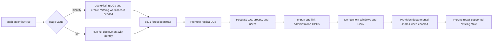

# Identity and Domain Join

[Back to README](../README.md)

## Identity Flow

When `enableIdentity=true`, the identity stage runs this sequence:

```text
Primary DC forest bootstrap
        ->
Replica DC promotion
        ->
Directory population
        ->
Group Policy provisioning
        ->
Windows and Linux domain join
        ->
Departmental share provisioning (when enabled)
```

| Step | Purpose and result |
|---|---|
| Primary forest | Turns the primary DC into the lab's AD forest and domain DNS anchor. |
| Replicas | Adds DCs to the same domain for additional directory/DNS endpoints. |
| Population | Creates the modeled departmental OUs, users, managers, and security groups. |
| Group Policy | Establishes Windows administrator and LAPS policies before workload joins. |
| Domain joins | Places Windows/Linux workloads in their role OUs and enables domain authentication. |
| Optional services | Provisions departmental shares and Linux client desktops. Desktop prerequisites run before Linux joins. |

The primary DC and replica DCs must already exist before a standalone `identity` stage can complete. Missing workload VMs may be created during the identity stage so they are available for domain joining. Generated user passwords need a separate secure reset/delivery process before interactive user testing.



## Directory Model

The default hierarchy puts workload computers under `_ROOT/Computers/Servers` or `_ROOT/Computers/Clients`, groups under `_ROOT/Groups`, and departmental accounts under `_ROOT/Users`. Users enter department global security groups; those groups nest into domain-local permission groups for shares (AGDLP). This connects account population to actual resource access rather than creating unrelated sample objects.

The `directoryModel` object in `modules/stages/identity-stage.bicep` is passed as a JSON string to identity scripts that require directory structure, group naming, OU mapping, GPO names, or share configuration. It centralises those details so the scripts do not hardcode AD structure:

- `rootOuName` — top-level OU beneath the domain root (`_ROOT`).
- `customOus` — hierarchical OU structure for computers, groups, and users, including reserved OUs for disabled users.
- `computerOuMapping` — maps VM types to OU locations (e.g. `srvwin`/`srvlin` → `Computers/Servers`, `cliwin`/`clilin` → `Computers/Clients`).
- `groupOuMapping` — OUs for global security groups (`Groups/GGS`) and domain local security groups (`Groups/DLGS`).
- `groupNaming` — configurable prefixes: `globalSecurityPrefix` (`GGS`) for user-facing department groups, `domainLocalSecurityPrefix` (`DLGS`) for share permission groups.
- `platformAdminGroups` — names of the Windows/Linux platform admin groups and the department code they're sourced from.
- `gpoNames` — display names for the Server Administration, Client Administration, Windows LAPS, and Domain Controller WinRM GPOs. The configurator creates and reconciles all four directly in Active Directory.
- `shares` — root share name/path (`C:\Shares`) and the current file server host (`fileServerName`).
- `coreOuMapping` — references to the core `Users`/`Groups` OUs used by scripts.

The directory model is not parameterised; it represents a stable architectural decision. Customisation requires editing `modules/stages/identity-stage.bicep` directly.

## Directory Population Rules

`Populate-AD.ps1` enforces these rules on every run (greenfield and brownfield):

- **Manager rule**: exactly one manager per department, identified by a title matching `*Manager*`. If multiple exist, the first is retained and others are demoted. If none exists, a new manager is created from an unused CSV record.
- **Reporting lines**: unmanaged users are assigned to their department's manager; users with invalid or cross-department reporting lines are reassigned.
- **User targets**: `usersPerDepartment` is enforced as a minimum for standard users (managers counted separately). Under-populated departments are topped up; over-populated departments are left as-is.
- **New user addition**: added round-robin across departments that still need users; username collisions are skipped, and population stops with a warning when unique CSV names are exhausted.
- **New account passwords**: each newly created manager or standard AD user receives an independent 24-character password generated with a cryptographic random-number generator. Existing users' passwords are not reset. Generated passwords are not written to Run Command output or retained for retrieval, so user onboarding needs a separate secure password-reset or delivery process.
- **Platform administrator groups**: Windows and Linux administrator groups are reconciled to the configured `platformAdminGroups.sourceDepartmentCode`; memberships from a previous source department are removed when the configuration changes.
- **Department removal**: removing a department from `additionalDepartments` does not delete its OU or users; the OU becomes unmanaged rather than deleted.

Reruns preserve object identities while repairing the selected attributes and memberships above. They are not a general directory teardown or exact-state replacement.

## Windows LAPS Active Directory Configuration

During directory population, `Ensure-LapsConfiguration` checks for the `ms-LAPS-Password` schema attribute and extends the AD schema with `Update-LapsADSchema` only when it is missing. It grants computer self-update permission separately on the Servers and Clients OUs, then grants the configured Windows administrators group (default `GGS_Windows_Admins`) permission to read LAPS passwords on both OUs.

The linked Windows LAPS GPO supplies the policy side of this setup: it backs passwords up to Active Directory. `Configure-GPOs.ps1` creates or reconciles its backup directory, password complexity, password length, password age, and authorized decryptor settings directly in the GPO. The decryptor is derived from the live NetBIOS domain and the Windows administrators group in `directoryModel`.

## Departmental File Services

When `enableFileServices=true`, directory population creates each department's `Share_RW` and `Share_RO` domain-local groups and nests the manager and user groups into them. Share provisioning is handled separately on the selected file server.

After Windows domain join completes, `Populate-Shares.ps1` runs on the selected file server. It creates `C:\Shares`, creates one SMB share per selected department, and applies the domain-local groups as NTFS Modify and Read-and-Execute permissions. The script retains existing directories and SMB shares and reapplies the expected ACL rules on reconciliation.

With `useDedicatedFileServer=false`, the selected host is the primary DC. With `useDedicatedFileServer=true`, it is the first `srvwin` VM in the final placement model. See [File Server Reassignment on Brownfield Expansion](placement-and-reconciliation.md#file-server-reassignment-on-brownfield-expansion) before changing this setting in an existing environment.

## Reconciliation

Identity operations use Azure VM Run Command resources. A new deployment name changes the Run Command definition and causes the command to be reapplied. The scripts inspect the current state rather than relying on a persisted reconciliation token.

Examples:

- Forest bootstrap exits when an AD domain already exists.
- Replica promotion exits when the target server is already a DC.
- Windows domain join exits when `PartOfDomain` is true.
- Linux domain join skips `realm join` when the VM is already joined.
- Directory population restores missing OUs, groups, users, and memberships.

## Windows Domain Join

Windows workload VMs are targeted from `finalVmPlacements` after Group Policy provisioning completes. The PowerShell script checks `Win32_ComputerSystem.PartOfDomain`; retained members skip the join. For a new join, it joins the configured domain and OU, verifies membership, and restarts the machine. Local Administrators membership is managed by Group Policy, not by this script.

After confirming the requested domain, the join script reconciles `HTTP/<computer>` and `HTTP/<computer>.<domain>` SPNs on that VM's own computer account using `setspn -S`. It does this for both already-joined and newly joined VMs. A separate `workload-winrm.bicep` Run Command runs after the join stage (and any required restart), refreshes computer policy, verifies the all-profile Administration GPO rule for TCP 5985 from `10.0.0.0/8`, and removes the legacy per-VM firewall rule only after that GPO rule is active.

During identity stage, `dc-winrm.bicep` performs the corresponding per-DC SPN reconciliation, refreshes computer policy, verifies the dedicated Domain Controllers GPO rule, and removes the legacy local rule after verification. The DC GPO allows inbound TCP 5985 from `10.0.0.0/8` on all profiles and is linked to the built-in Domain Controllers OU. WAC waits for both workload and DC firewall-policy reconciliation.

## Group Policy Provisioning

After directory population, `modules/identity/ad-gpo.bicep` runs `Configure-GPOs.ps1` on the primary DC to create or reconcile all four GPOs directly; no GPMC backup ZIP is used.

GPO names come from the directory model, so the script does not hardcode them:

```text
gpoNames.serverAdministration   ->  linked to OU=Servers,OU=Computers
gpoNames.clientAdministration   ->  linked to OU=Clients,OU=Computers
gpoNames.windowsLaps           ->  linked to OU=Servers,OU=Computers and OU=Clients,OU=Computers
gpoNames.domainControllerWinRM ->  linked to OU=Domain Controllers
```

Windows LAPS is linked separately to the Servers and Clients OUs. The Windows administrators group-reference rewrite applies only to the two administration GPOs.

The Server Administration and Client Administration GPOs configure WinRM service startup and listener policy and allow TCP 5985 and 5986 from `10.0.0.0/8` on all firewall profiles. Their Local Users and Groups preference adds `AMRL\GGS_Windows_Admins` to built-in Administrators without clearing other members. The generated Domain Controller WinRM GPO allows TCP 5985 from the same internal range on all profiles. Windows LAPS policy is configured directly in its GPO. The current WAC configuration uses WinRM over HTTP (5985); the 5986 firewall allowance does not create an HTTPS listener or certificate.

Missing GPOs are created with `New-GPO`; reruns reapply the settings managed by this configurator and repair the modeled links. Unrelated settings on existing GPOs are not wholesale-cleared. Verify client processing separately.

<details>
<summary>GPO implementation and rerun boundaries</summary>

`Configure-GPOs.ps1` creates the Server Administration, Client Administration, Windows LAPS, and Domain Controller WinRM GPOs when absent. It configures WinRM service startup/listener policy, the all-profile internal firewall rules, the add-only local Administrators preference, and the five Windows LAPS values from the attached policy reports. It repairs the modeled links and re-applies those settings on reruns; it does not import or overwrite whole GPO backups.

`treatFailureAsDeploymentFailure` is enabled on the Run Command, so a guest-script failure fails the deployment instead of reporting success.

### Idempotency and Policy Scope

The configurator owns the policy settings described above. Be aware of these boundaries:

- **GPO names are not coupled to backups.** They are used directly when creating the GPOs and linking them to the modeled OUs.
- **The local Administrators preference is additive.** It reconciles the Windows administrators entry and preserves other members of the built-in group.
- **Unmodeled GPO settings are preserved.** This configurator is not a blanket reset of administrator-added settings.
- **Re-running requires a new Run Command definition.** As with the other identity scripts, use a new deployment name so the Run Command is reapplied.

</details>

## Linux Domain Join

Linux workload VMs use `realmd`, `adcli`, Kerberos, and SSSD. The script:

1. Validates required inputs.
2. Checks existing realm membership.
3. Installs prerequisites when the VM still needs to join or requires healing.
4. Discovers the domain when a join is required.
5. Runs verbose `realm join` for an unjoined VM.
6. Configures SSSD, automatic home directories, realm access, and Linux administrator sudo rights.
7. Sets the VM hostname to its FQDN (`<hostname>.<domainName>`) and enables SSSD dynamic DNS so the VM registers its own A/PTR records, then triggers an immediate `adcli update` instead of waiting for the next refresh interval.
8. Validates the resulting realm state.

Already joined Linux VMs skip package installation, discovery, and joining but continue the SSSD, access, sudo, and validation steps. This preserves the healing path for partially configured machines.

### Linux Endpoint Administration Reconciliation

On every identity-stage run, the Linux script reconciles selected SSSD keys, restarts SSSD when one of those keys changes, ensures the `pam_mkhomedir.so` session module is present, and sets the realm login policy to `allow-realm-logins`. That realm policy allows all domain users to log in; administrative sudo is separately limited by the model-derived `GGS_Linux_Admins` sudoers rule. The script checks both the rule content and file mode (`0440`), writes changes to a temporary file, validates them with `visudo`, and then installs the file. This is selective reconciliation of those settings, not a replacement of the full SSSD or host configuration.

## Linux Client Desktop Installation

Before Linux clients (`clilin`) join the domain, `modules/compute/linux-desktop.bicep` runs a Run Command that installs `ubuntu-desktop-minimal` and `xrdp`, enabling RDP-based GUI access. It also configures a broad lab Polkit rule granting the modeled Linux administrator group desktop-action authorization in active, inactive, and other contexts. `domainJoinLinux` depends on this step so the desktop environment is present before the client is joined.

Bash scripts are stored with LF line endings through `.gitattributes`:

```gitattributes
*.sh text eol=lf
```

## Troubleshooting

Inspect the VM Run Command instance view when a job exists but a VM is not joined:

```powershell
az vm run-command show `
        --resource-group "<resource-group>" `
        --vm-name "<vm-name>" `
  --run-command-name join-domain-linux `
  --expand instanceView
```

A successful Run Command resource deployment does not necessarily mean that the guest script succeeded. Check `executionState`, `exitCode`, `error`, and `output`.

[Back to README](../README.md)
